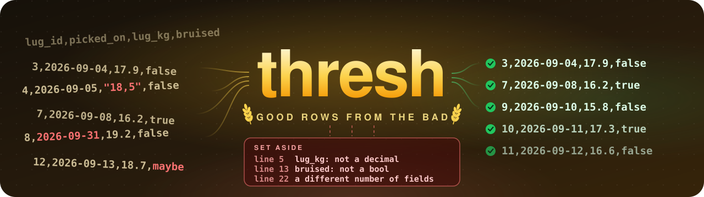
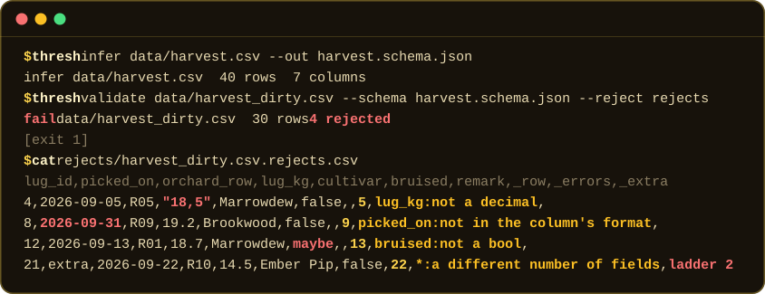
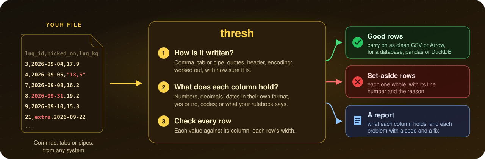

<p align="center">
  
</p>

<h3 align="center">Separate the good rows from the bad, before they reach your database.</h3>

<p align="center">
  🔎 Every bad row, with its line and the reason &nbsp;·&nbsp;
  🛑 Stops rather than guesses<br>
  📦 One download, nothing else to install &nbsp;·&nbsp;
  ⚡ Hundreds of megabytes a second
</p>

<p align="center">
  <a href="#-see-it-work"><b>See it work</b></a> &nbsp;·&nbsp;
  <a href="#-get-it"><b>Get it</b></a> &nbsp;·&nbsp;
  <a href="examples/README.md"><b>Walkthrough</b></a> &nbsp;·&nbsp;
  <a href="docs/README.md"><b>Docs</b></a>
</p>

<p align="center">
  <a href="https://github.com/kmoneil/thresh/releases/latest"></a>
  <a href="https://pypi.org/project/threshio/"></a>
  <a href="https://github.com/kmoneil/thresh/actions/workflows/ci.yml"></a>
  <a href="LICENSE"></a>
</p>

---

## 🤔 What is thresh?

Data travels in files: a supplier's price list, last night's orders, an
export from another team's system. Most are **CSV files**, plain text
with one row on each line and commas (or tabs, or pipes) between the
values. You load one into a database or a spreadsheet and the load
fails: *"line 4187 has the wrong number of columns"*. Which line is that?
What is wrong with it? Is the rest of the file fine?

**thresh answers all three in one command.** It works out how the file
is written and what each column holds, checks every row, and sets the
bad ones aside, each with its line number and the reason. The good rows
carry on to wherever they were going.

<sub>New to words like *delimiter*, *encoding* or *schema*? The
[glossary](docs/README.md#-glossary) explains each in a line.</sub>

<p align="center">
  
</p>

## 🧐 What it catches

Real problems, from real feeds, and what thresh does about each.

| In the file | What a loader typically does | What thresh does |
| --- | --- | --- |
| A weight written `18,5`, with a decimal comma | reads the whole column as text, or stops | sets that row aside: *lug_kg: not a decimal* |
| A date that does not exist, `2026-09-31` | loads it as text, or fails the whole load | sets that row aside: *picked_on: not in the column's format* |
| `maybe` in a yes/no column | turns the column into text | sets that row aside: *bruised: not a bool* |
| One row with a field too many | stops, or drops the row without a word | sets that row aside, and keeps the extra field |
| Commas in a comment nobody quoted | picks a reading and carries on | stops, and says what to tell it ([see](examples/README.md#commas-nobody-quoted)) |
| An inch mark, `"36`, in a file that never quotes | runs the next lines together into one value | stops: *the quotes look like data* ([see](examples/README.md#inch-marks-in-a-file-that-never-quotes)) |
| A header one name short | shifts the names along by a column | stops: it cannot tell which name is missing ([see](examples/README.md#a-header-one-name-short)) |
| Two exports joined, the header again halfway down | reads the second header as a row | skips it, and says so ([see](examples/README.md#two-exports-joined)) |
| Tuesday's file has a column Monday's lacks | finds out at load time | says the files disagree, and on which column ([see](examples/README.md#deliveries-that-disagree)) |
| A Windows export with `café` in it | shows `caf�`, or fails | says it is not UTF-8, and which encoding to read it with ([see](examples/README.md#a-windows-export)) |

## ⚙️ How it works

<p align="center">
  
</p>

Where thresh cannot be sure how a file is written, it stops and says
what to tell it, rather than guess and load the wrong thing.

## ✨ What can it do?

<table>
<tr>
<td width="33%" valign="top">

**🔎 Read any delimited file**<br>
Works out the delimiter, the quoting, the header and the encoding,
and says how sure it is.
<br><sub>[Walkthrough →](examples/README.md#a-clean-file)</sub>

</td>
<td width="33%" valign="top">

**🧠 Know what each column holds**<br>
Whole numbers, decimals and their precision, dates in the format they
are written, yes or no, short lists of codes.
<br><sub>[Walkthrough →](examples/README.md#a-clean-file)</sub>

</td>
<td width="33%" valign="top">

**🚦 Check every row**<br>
A bad row is set aside, whole, with its line number and the reason.
The good rows carry on.
<br><sub>[Walkthrough →](examples/README.md#what-a-bad-delivery-looks-like)</sub>

</td>
</tr>
<tr>
<td valign="top">

**📋 Keep a rulebook for each feed**<br>
Write down once what a feed's files should hold (a *schema*), made
from a good file, and check every delivery against it.
<br><sub>[Walkthrough →](examples/README.md#a-clean-file)</sub>

</td>
<td valign="top">

**📁 A whole folder at once**<br>
Thousands of files in one command, side by side on every core, each
passed or failed; and it says when a feed's files disagree.
<br><sub>[Walkthrough →](examples/README.md#deliveries-that-disagree)</sub>

</td>
<td valign="top">

**🙈 Share the problem, not the data**<br>
`--shapes-only` writes `Ember Pip` as `a a` and `2026-09-22` as
`9-9-9`, so a report can go to a vendor, a colleague or an AI.
<br><sub>[See it →](#-share-the-problem-not-the-data)</sub>

</td>
</tr>
<tr>
<td valign="top">

**✨ Clean output**<br>
The good rows as tidy CSV, or as Arrow, which pandas, polars and
DuckDB read straight in.
<br><sub>[Walkthrough →](examples/README.md#a-clean-file)</sub>

</td>
<td valign="top">

**🧾 A report for people and programs**<br>
What each column holds, and every problem as a code that does not
change, with the fix where there is one.
<br><sub>[Report format →](docs/REPORT.md)</sub>

</td>
<td valign="top">

**🌍 Old systems welcome**<br>
UTF-8, Windows-1252, Latin-1 and UTF-16; records padded to a fixed
length; exports joined end to end.
<br><sub>[Walkthrough →](examples/README.md#a-windows-export)</sub>

</td>
</tr>
<tr>
<td valign="top">

**🤖 Ready for AI**<br>
`describe` puts everything thresh knows of a file in one JSON
document, small enough for a prompt however big the file.
<br><sub>[Walkthrough →](examples/README.md#the-whole-of-a-file-in-one-document)</sub>

</td>
<td valign="top">

**🐍 From Python**<br>
`pip install threshio`: the same checks, and the rows straight into
pyarrow, pandas or polars.
<br><sub>[threshio →](python/README.md)</sub>

</td>
<td valign="top">

**🧩 From C and other languages**<br>
libthresh hands rows and rejected rows to Arrow readers in the same
process, without a copy.
<br><sub>[C library →](docs/C.md)</sub>

</td>
</tr>
</table>

## 👀 See it work

Real commands and real output, on the small files in
[examples/](examples): an invented orchard's harvest, in the shapes real
feeds arrive in. The tests run every one of these commands and fail if
thresh prints anything else.

### 🚦 A bad delivery in, the good rows kept

A delivery with a decimal comma, a day that does not exist, a yes/no
column saying "maybe" and one row a field too wide. `infer` makes a
rulebook (a schema) from a good delivery; `validate` checks the bad one
against it:

<!-- card: docs/assets/harvest.svg -->
```console
$ thresh infer data/harvest.csv --out harvest.schema.json
infer data/harvest.csv  40 rows  7 columns
$ thresh validate data/harvest_dirty.csv --schema harvest.schema.json --reject rejects
fail  data/harvest_dirty.csv  30 rows  4 rejected  1 MB/s
[exit 1]
$ cat rejects/harvest_dirty.csv.rejects.csv
lug_id,picked_on,orchard_row,lug_kg,cultivar,bruised,remark,_row,_errors,_extra
4,2026-09-05,R05,"18,5",Marrowdew,false,,5,lug_kg:not a decimal,
8,2026-09-31,R09,19.2,Brookwood,false,,9,picked_on:not in the column's format,
12,2026-09-13,R01,18.7,Marrowdew,maybe,,13,bruised:not a bool,
21,extra,2026-09-22,R10,14.5,Ember Pip,false,22,*:a different number of fields,ladder 2
```

Each set-aside row is there whole, as it was in the file, with three
columns added: `_row`, its line number; `_errors`, the column and what
is wrong with it; and `_extra`, any fields past the last column. The
other 26 rows passed.

> [!TIP]
> Without a rulebook, thresh can still find the rows that do not fit the
> file's shape, like the wide row above, but not a bad value: with
> nothing to say otherwise, a column holding `maybe` is just text. Make
> the rulebook once from a good delivery, and check every delivery
> against it.

### 🛑 Where it cannot be sure, it stops

A comment column with commas nobody quoted, a header a name short of its
rows, deliveries of one feed that no longer agree. thresh will not
guess, and says what it would need:

```console
$ thresh sniff data/remarks.csv
data/remarks.csv: delimiter=, quote=" escape=doubled newline=lf header=yes confidence=low
thresh: data/remarks.csv: the dialect is not settled (confidence low, score 0.57); pin it with --delimiter, --quote, --escape, --newline and --header
[exit 2]
$ thresh sniff data/header_short.csv
thresh: data/header_short.csv: row 1 is a header of 3 names over rows of 4 fields, and which names go with which columns cannot be told; fix the header, or pin --header no to read row 1 as data
[exit 2]
$ thresh infer data/monday.csv data/tuesday.csv --out week.schema.json --jobs 1
infer data/monday.csv  20 rows  4 columns
infer data/tuesday.csv  20 rows  5 columns
thresh: the files disagree: 1 of the schema's 5 columns is not in every file: 'brix' (1 of 2); validate fails a file without one
[exit 1]
```

### 📏 It will not run your rows together

An export that never quotes, with an inch mark typed before a number
(`"36`). A CSV reader takes the mark for an opening quote and runs on
over the next lines as one value, so a loader gets one strange row where
there were several. thresh sees that each of those lines is a whole row
without the quote:

```console
$ thresh sniff data/bins.txt
data/bins.txt: delimiter=| quote=" escape=doubled newline=lf header=yes confidence=high warnings=quote_in_unquoted
thresh: data/bins.txt: the quotes look like data: on line 13 a value that starts with a quote (field 3) runs on to the next one, so lines 13 to 16 read as one record; each line is a whole row without the quotes: pin --quote none to read quotes as data
[exit 2]
```

### 🙈 Share the problem, not the data

A file you cannot send anywhere still has problems you need help with.
`--shapes-only` writes every value as its shape: letters become `a`,
digits `9`, and the punctuation stays. Here is line 22, the wide row,
and the same line as the report gives it:

```console
$ sed -n 22p data/harvest_dirty.csv
21,extra,2026-09-22,R10,14.5,Ember Pip,false,ladder 2
$ thresh describe data/harvest_dirty.csv --shapes-only > harvest_dirty.json
fail  data/harvest_dirty.csv  30 rows  1 rejected  1 MB/s
[exit 1]
$ grep '"text"' harvest_dirty.json
      "text": "9,a,9-9-9,a9,9.9,a a,a,a 9",
```

Enough to see the row has one field too many, and nothing of what was in
it. `--shape-names` hides the column names too.

The [walkthrough](examples/README.md) has the rest: padded fixed-length
records, Windows and UTF-16 exports, joined files, the report itself and
the `describe` document.

## 🚀 Get it

Pick the door that suits you.

### 📦 Download

Download the file for your computer from the
**[latest release](https://github.com/kmoneil/thresh/releases/latest)**,
unpack it, and run `thresh` from a terminal. It is one file, with
nothing else to install.

| Your computer | The file whose name ends in |
| --- | --- |
| Mac with Apple silicon (M1 or later) | `macos-arm64.tar.gz` |
| Mac with an Intel chip | `macos-x86_64.tar.gz` |
| Windows, most PCs | `windows-x86_64.zip` |
| Windows on Arm (Snapdragon) | `windows-arm64.zip` |
| Linux, most PCs and servers | `linux-x86_64.tar.gz` |
| Linux on Arm (Graviton, Ampere, a Raspberry Pi with a 64-bit system) | `linux-arm64.tar.gz` |

<details>
<summary><b>Step by step on a Mac</b></summary>

1. Download the file and double-click it, if your browser has not
   already unpacked it: Finder unpacks it into a folder.
2. Open **Terminal** and go into that folder, for example
   `cd ~/Downloads/thresh-*-macos-arm64`.
3. thresh is not signed by Apple, so macOS stops a program downloaded
   from the internet the first time. Clear that once:
   `xattr -d com.apple.quarantine thresh`.
4. Try it: `./thresh --version`.
5. To run it as `thresh` from anywhere, move it onto your path:
   `sudo mv thresh /usr/local/bin/`.

</details>

<details>
<summary><b>Step by step on Windows</b></summary>

1. Download the zip, right-click it and choose **Extract All**.
2. Open the extracted folder, right-click an empty space in it and choose
   **Open in Terminal** (on Windows 10, hold Shift as you right-click and
   choose **Open PowerShell window here**).
3. Try it: `.\thresh.exe --version`.
4. To run it as `thresh` from anywhere, put the folder on your `Path`
   (Settings, search for "environment variables").

</details>

<details>
<summary><b>Step by step on Linux</b></summary>

```sh
tar -xzf thresh-*-linux-x86_64.tar.gz
./thresh-*-linux-x86_64/thresh --version
sudo mv ./thresh-*-linux-x86_64/thresh /usr/local/bin/
```

One build runs on every distribution: it needs no C library, glibc or
musl.

</details>

<details>
<summary><b>Check the download</b></summary>

Each release has `SHA256SUMS`, the checksum of every file, and GitHub's
record of the workflow and commit that built each one, which the
[GitHub CLI](https://cli.github.com) checks:

```sh
shasum -a 256 -c SHA256SUMS --ignore-missing
gh attestation verify thresh-*-macos-arm64.tar.gz --repo kmoneil/thresh
```

</details>

### 🐍 From Python

```sh
pip install threshio
```

The library, with the command's checks, for Python 3.9 and later on
macOS, Linux and Windows. [threshio's README](python/README.md) shows it
at work.

### ⚡ From source

With [Zig 0.17.0](https://ziglang.org/download/): `zig build --release`
builds `zig-out/bin/thresh` and the C library.
[Under the hood](#-under-the-hood) has the rest.

## 💪 Why trust it?

<table>
<tr>
<td align="center" width="25%"><h3>47</h3></td>
<td>commands, on this page and in the <a href="examples/README.md">walkthrough</a>, run on every change on Linux, macOS and Windows, with their output compared line by line. If thresh printed anything else, the build would fail.</td>
</tr>
<tr>
<td align="center"><h3>177</h3></td>
<td>test files in every delimiter, quoting, line ending, header and encoding, and in the shapes of real exports, each with the answer thresh must give.</td>
</tr>
<tr>
<td align="center"><h3>6</h3></td>
<td>downloads, for Mac, Windows and Linux on Intel and Arm, each unpacked and run on its own kind of computer before a release can publish it.</td>
</tr>
<tr>
<td align="center"><h3>350 MB/s</h3></td>
<td>checked on one core of an M5 Max, as released, and every core takes a file of its own. <a href="docs/PERF.md">docs/PERF.md</a> has the numbers, stage by stage.</td>
</tr>
<tr>
<td align="center"><h3>🛡️</h3></td>
<td>Fuzzed: random and broken files thrown at it for hours, and thresh must answer each with a result or a report, never crash. Its own safety checks stay on in the release, so if something inside ever went wrong it would stop rather than give a wrong answer.</td>
</tr>
</table>

## 🙋 Who is it for?

- 🎫 **Whoever holds the ticket when a load fails:** the bad rows and
  why, without opening a file too big for your editor.
- 🏭 **Data and analytics engineers:** a gate before the warehouse, with
  the bad rows set aside and the good rows on as clean CSV or Arrow.
- 📥 **Teams that take files from outside:** suppliers, partners, other
  systems. Write down what each feed should hold, and check every
  delivery.
- 🔒 **Anyone who cannot send the file:** share the shapes of the
  problem with a vendor or an AI, and none of the data.
- 🐍 **Python developers:** checked rows straight into pyarrow, pandas or
  polars.
- 🤖 **AI agents and their builders:** a file's whole story in one
  bounded JSON document.

## 📚 Learn more

| I want to... | Read |
| --- | --- |
| see thresh on every kind of file, with real output | [🧺 Walkthrough](examples/README.md) |
| look up a word | [📖 Glossary](docs/README.md#-glossary) |
| know every field in a report | [🧾 Report format](docs/REPORT.md) |
| look up a problem code and its fix | [🩺 Problem codes](docs/PROBLEMS.md) |
| use thresh from Python | [🐍 threshio](python/README.md) |
| use thresh from C, or another language through C | [🧩 C library](docs/C.md) |
| know how fast it is, and why | [🏎️ Performance](docs/PERF.md) |
| see what changed in each release | [📜 Changelog](CHANGELOG.md) |

All of them, with a line on each, are on the [docs home](docs/README.md).

## 🔬 Under the hood

For developers: the commands in full, the library, and how thresh is
built and tested.

### Commands

```
thresh sniff    <file>...                       dialect, confidence, header verdict
thresh infer    <file>... [--out schema.json]   type inference across files; writes a schema
thresh validate <file>... --schema s.json       report, and rejected rows with their reasons
thresh convert  <file>... --to csv|arrow        writes output; infers types if no --schema
thresh run      <file>... --schema s.json --to arrow --out dir/
thresh describe <file>... [--schema s.json]     everything about each file in one JSON document
                [--reject dir/] [--report dir/]  and its rejected rows and report, no schema needed
```

Files run in parallel, one per worker (`--jobs`, default one per CPU).
Ctrl-C stops a run with no partial output file. `thresh --help` lists
every option.

**Reports.** `--report DIR` writes a JSON report per file and a
`summary.json`; `--json` prints one object per file; `--reject DIR`
writes each failing row with its source line (`_row`), its errors
(`_errors`) and a wide row's fields past the header (`_extra`).
`describe` writes both too, so one command, with no schema written
first, gives everything thresh knows of a file and every row it set
aside. [docs/REPORT.md](docs/REPORT.md) describes every field and what
may change between versions; [docs/PROBLEMS.md](docs/PROBLEMS.md) lists
every code. `--shapes-only` writes every value in them as its shape
(`AB_CD_12` is `a_a_9`), and `--shape-names` the column names too, so a
report can be shared without the data.

**Exit status.** 0 every file passed; 1 a file failed validation but
every file was processed (infer: the files disagree on their columns); 2
a file could not be read or its dialect could not be settled; 3 a usage
error.

**Arrow.** The stream format by default, the file format with
`--arrow-file`; it reads straight into pyarrow, polars or DuckDB. Until
thresh writes Parquet, DuckDB converts in one line: `duckdb -c "INSTALL
arrow FROM community; LOAD arrow; COPY (FROM read_arrow('x.arrows')) TO
'x.parquet'"`.

### From code

The same build installs **libthresh**, static and shared, and its
header, `zig-out/include/thresh.h`. Sniff, infer and validate return the
JSON documents of [docs/REPORT.md](docs/REPORT.md); read hands the rows
and the rejected rows to pyarrow, polars or DuckDB as Arrow C streams,
moved rather than copied.

```c
thresh *t = thresh_new();
char *schema, *report;
thresh_columns(t, "lug_id:int64,lug_kg:decimal(5,2)", &schema);
thresh_validate(t, "lugs.csv", schema, NULL, &report);   /* the file report, as JSON */
```

A file's own trouble is in its report, never an error code, so a caller
acts on codes rather than parsing sentences. [docs/C.md](docs/C.md) has
the calls, ownership and threads.

From Python, [threshio](python/README.md) is the library with no other
dependency (`pip install threshio`):

```python
import pyarrow, threshio

schema = threshio.infer("lugs.csv").schema
report = threshio.validate("lugs.csv", schema)   # .passed, .rejected_lines, .problems
table = pyarrow.table(threshio.read("lugs.csv", schema))
```

[examples/python](examples/python) has whole scripts, each with its
output.

### Build

Zig 0.17.0.

```sh
zig build --release       # zig-out/bin/thresh and libthresh, ReleaseSafe: what a release ships
                          # (python3 -I tools/release_archives.py packs the
                          # command for every platform into zig-out/release)
zig build                 # Debug
zig build test            # unit tests, the corpus, the command, examples/ and this page
                          # (-Dcorpus=false skips the parts needing python3)
zig build fmt-check       # zig fmt --check
zig build vet             # zigvet, built from the pinned dependency
zig build complexity      # gnarl: no function more complex than complexity.baseline allows
zig build corpus          # the fixture corpus, into zig-out/corpus (python3)
zig build bench           # MB/s per parsing stage, ReleaseFast (-- --size BYTES)
zig build scale -Doptimize=ReleaseFast  # 10,000 files, MB/s by --jobs, Ctrl-C
zig build fuzz            # replay the fuzz seeds; tools/fuzz.sh [LIMIT] fuzzes
                          # (tools/vmrun/vmrun tools/vmrun/jobs/fuzz.sh for
                          # hours on a GCP spot VM; vmrun's header says what
                          # it needs)
zig build arrow-check     # Arrow output and C streams read back by pyarrow and DuckDB
```

The terminal picture near the top is drawn from the first example under
[See it work](#-see-it-work) by `tools/console_cards.py`, and the build
fails if the two differ, so it shows what thresh prints today.

### Speed

Fast enough not to be the bottleneck: a few hundred MB/s per file per
core in the shipped build, files in parallel across cores. Releases are
ReleaseSafe, keeping Zig's runtime checks (bounds, overflow, assertions),
because thresh reads files nobody vouches for and a broken invariant
should stop it rather than give a wrong answer; that costs a quarter to a
third of ReleaseFast's speed. [docs/PERF.md](docs/PERF.md) has the
numbers, stage by stage, and the regression gate.

### How it is tested

- A SIMD structural index checked against a scalar reference parser, on
  random inputs and under a fuzzer (`tools/fuzz.sh`), and the C library's
  calls fuzzed on any file, schema and options, held to return a status
  or a report, never to panic.
- A fixture corpus written by `test/gen/corpus.py`: 177 files across
  delimiter, quote, newline, header, encoding and field profiles, an
  adversarial set, and a set in the shapes of real exports, each with its
  expected dialect, schema and field boundaries. It is regenerated by the
  build; `test/gen/MANIFEST` holds every file's SHA-256, so the build
  fails if it moves.
- The command itself, its output, files and exit status (`cli_checks` in
  `build.zig`), and this page and the examples, run as written.
- pyarrow and DuckDB read the Arrow output back, and pyarrow the C
  library's streams, value for value against the CSV output
  (`zig build arrow-check`); a C program drives the library through its
  header alone, linked static and shared.
- threshio's wheel for each platform installed there and its tests run
  against it: Linux (glibc and musl), macOS and Windows, on x86-64 and
  arm64, with every block of its README and every script in
  `examples/python` run as written.
- Each release's downloads unpacked and run on their own platforms
  (`.github/workflows/binaries.yml`) before they are published.
- Tests in Debug and ReleaseSafe in CI, and a benchmark gate on every pull
  request.

Dates go through [dateparsa](https://github.com/kmoneil/dateparsa.zig);
[zigvet](https://github.com/kmoneil/zigvet) checks the sources for code Zig
compiles that is almost certainly wrong, and
[gnarl](https://github.com/kmoneil/gnarl) holds each function's complexity
to a ratchet: none new over a critical limit, none worse than
`complexity.baseline` says.

## 📜 Status and license

Early, and tried on real feeds. Problems are codes as well as sentences,
the reports have a [versioned format](docs/REPORT.md), and thresh is a
[C library](docs/C.md) and a [Python package](python/README.md) as well
as a command. Each release, and what changed in it:
[CHANGELOG.md](CHANGELOG.md).

Apache-2.0; see [LICENSE](LICENSE).
